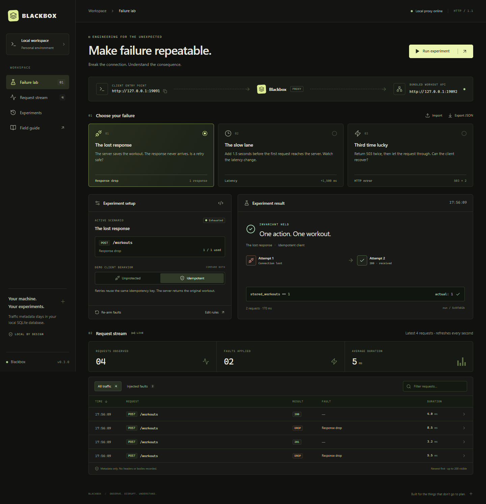
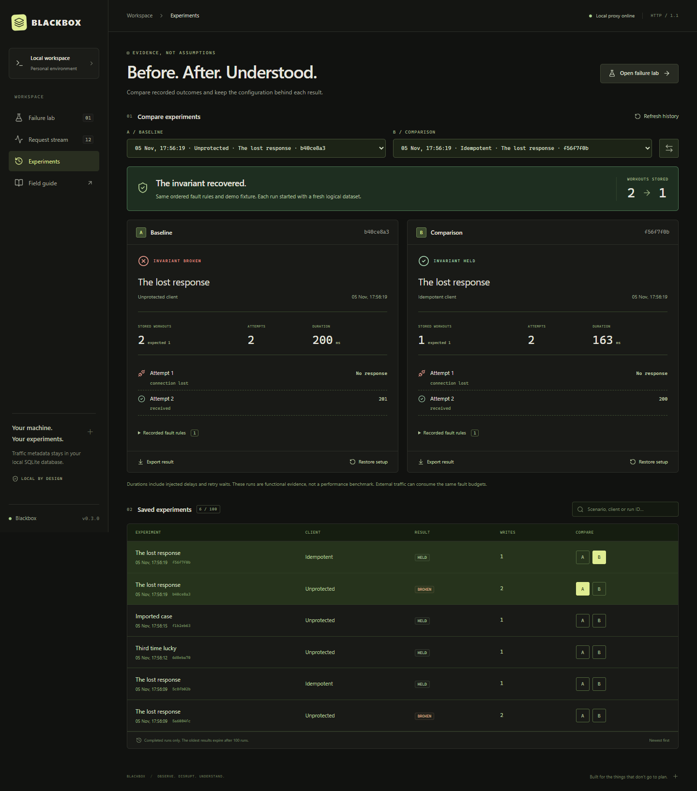
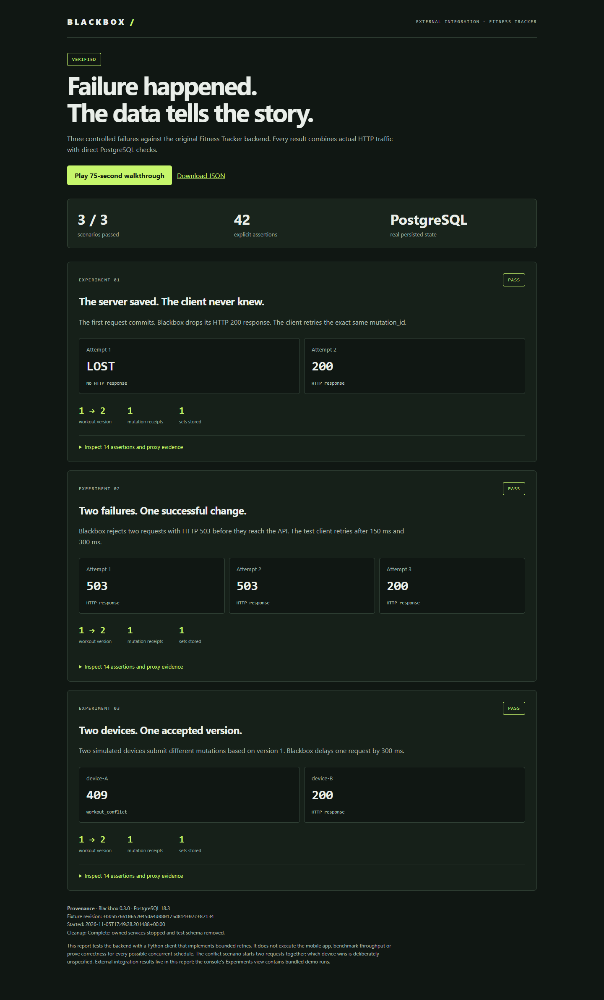

# BLACKBOX

**Make failure repeatable.** A local HTTP failure lab with a visual request stream, bounded fault injection and a demo that shows why retries need idempotency.

[](https://github.com/nerifilipe/blackbox/actions/workflows/ci.yml)

Built with **Go · React · TypeScript · SQLite**. The compiled application embeds its frontend and runs without Node.js, Go, a cloud account or an API key.

**New in v0.3:** reproduce three failures against the real Fitness Tracker backend and PostgreSQL: a lost response after commit, temporary 503s and concurrent edits. [Read the case study](docs/fitness-case-study.md), [inspect recorded evidence](docs/evidence/fitness/report.json), or [run it yourself](integrations/fitness/README.md).

**Independent compatibility check:** the published Windows release also passed nine scenarios and 62 assertions against the unmodified third-party JSON Server API. The tests exposed duplicate POST records after a lost response, including when the client repeated an idempotency header. [Results and scope](docs/third-party-validation.md) · [Reproduce](integrations/json-server/README.md).



## The experiment

One user action can create two database writes:

1. The client submits a workout.
2. The API commits it to SQLite and returns `201`.
3. Blackbox closes the client connection before delivering the response.
4. The client retries because it does not know whether the write succeeded.
5. An unprotected client creates **two workouts**. A client using the same idempotency key gets **one workout**.

These are real HTTP requests through a real proxy. The demo API is a small bundled fixture with synthetic data, independent of any existing fitness application. The request inspector distinguishes the upstream status from the status actually delivered to the client.

## Run the Windows build

If you have the Windows package, the executable is in `dist/blackbox.exe`. For a Git checkout, follow **Build from source** first; executables are not committed to the repository.

1. Double-click **`Start-Blackbox.cmd`**.
2. Open **http://127.0.0.1:9090**.
3. Keep **The lost response** and **Unprotected** selected, then click **Run experiment**.
4. Observe the failed invariant: `stored_workouts == 1`, actual `2`.
5. Select **Idempotent**, run again, and observe actual `1`.

Each run gets a fresh logical dataset and resets the fault counters. Stop the process with **Ctrl+C** in its terminal. History and the active scenario persist in `.blackbox/history.db`; fault counters restart at zero. No administrator rights are required.

| Service | Default address |
| --- | --- |
| Console and control API | `http://127.0.0.1:9090` |
| Proxy / client entry point | `http://127.0.0.1:9091` |
| Bundled workout API | `http://127.0.0.1:9092` |

## What is implemented

- **Response drop:** let the upstream return a response, then close the client connection without an HTTP response.
- **Latency:** delay a matching request before forwarding it; cancellation during that delay prevents forwarding.
- **HTTP error:** return a configured `400–599` status without contacting the upstream.
- Exact method/path matching, ordered rules and atomic per-rule fault budgets.
- A live request stream, metadata inspector, filters and real observed durations.
- JSON scenario editor, import, export and manual re-arming.
- A demo with unprotected and idempotent clients, explicit retries and database assertions.
- CLI scenario execution with machine-readable JSON and meaningful exit codes.
- SQLite history, an embedded web frontend and loopback-only listeners.
- An **Experiments** view with the last 100 completed runs, baseline/comparison selection and side-by-side attempts, writes and outcomes.
- Immutable per-run scenario snapshots, result downloads and restoration of a recorded setup.
- A pinned external Fitness Tracker integration with independent database assertions, HTML/JSON evidence and a 75-second offline walkthrough.

## Compare before and after

Run **The lost response** with the **Unprotected** client, then with the **Idempotent** client. Open **Experiments** in the sidebar. The older run becomes baseline A and the newer run becomes comparison B; selectors let you compare any two retained runs.

Blackbox compares the saved, enabled rules in their original order and the demo fixture version. It ignores display labels and settings irrelevant to the selected fault kind. Different configurations receive an explicit warning, even if their scenario names are identical. Durations include injected delays and retry waits; the comparison is functional evidence, not a performance benchmark. External traffic can still consume the same fault budgets.

**Export result** downloads the result and its configuration. **Restore setup** loads the saved rules and client mode into the lab and re-arms the scenario; it does not send requests until you start a new experiment.

Existing v0.1 history remains readable. Older runs have no configuration snapshot, so Blackbox marks them as legacy and disables restoration instead of guessing their original rules. No database reset is required.



## Connect your application

Stop the default instance, then start with your API's origin:

```powershell
.\dist\blackbox.exe serve -target http://127.0.0.1:8000
```

Set your application's API base URL to `http://127.0.0.1:9091`. In Blackbox, edit the rules to match your endpoint, for example `POST /api/v1/workouts`. Paths match exactly, excluding the query string. The first enabled matching rule with remaining budget wins. Other requests pass through normally.

The built-in experiment button is disabled for external targets. Send requests from your own application or test suite. Blackbox does not reset external databases or automatically repeat external writes.

The target must be an `http://` or `https://` origin, with no credentials, path, query or fragment. TLS verification is enabled for HTTPS upstreams. Client-to-proxy traffic is local HTTP. There is no TLS interception.

## Reproduce a scenario from the CLI

With the default demo server running:

```powershell
.\dist\blackbox.exe run -scenario scenarios/lost-response.json -mode fragile
# JSON result; exit code 1 because two workouts were stored.

.\dist\blackbox.exe run -scenario scenarios/lost-response.json -mode resilient
# JSON result; exit code 0 when one workout is stored and the client succeeds.

.\dist\blackbox.exe export -out my-case.json
```

Use `-url http://127.0.0.1:PORT` to select another local control instance. `serve -help` lists addresses and the SQLite file option. Use the analogous `./dist/blackbox` commands on Linux/macOS after building there.

## Test the real Fitness Tracker backend

With a compiled Blackbox binary, Python 3.14, Git and PostgreSQL 18 binaries installed:

```powershell
python integrations/fitness/start.py --postgres-bin "C:\Program Files\PostgreSQL\18\bin"
```

This prepares a pinned checkout and Python environment, starts an isolated local PostgreSQL cluster, applies the original migrations, creates synthetic data and executes three experiments. It emits an offline HTML report and JSON, then stops its services and removes the test schema. Exit code zero requires all scenarios and cleanup to succeed. First setup downloads dependencies.

| Failure | Observed result in the recorded run |
| --- | --- |
| Response disappears after commit | Same mutation retried; version increases once and one mutation receipt remains |
| Two injected 503s | No database change during errors; third attempt succeeds |
| Concurrent edits from version 1 | One succeeds, one receives `workout_conflict`; winning data survives |

The recorded run passed **42 assertions**. This exercises the original backend with a Python client; it does not execute the mobile application's offline queue. These results use their own report, separate from the bundled demo's history.

The report includes **Play 75-second walkthrough**, with actual results on each slide. See [setup and Docker instructions](integrations/fitness/README.md), the [architecture and case study](docs/fitness-case-study.md), [example HTML](docs/evidence/fitness/report.html), [video demonstration](docs/images/fitness-demo.webm), and [presentation script](docs/demo-script.md). Download the HTML to view it locally; GitHub displays its source rather than running it. The JSON download is embedded in the HTML.



## Build from source

Requirements: **Go 1.26 or later**, **Node.js 24**, and npm. Go may download a compatible toolchain if configured to do so. The first build requires network access to download dependencies; lockfiles are committed.

Windows:

```powershell
powershell -NoProfile -ExecutionPolicy Bypass -File scripts/build.ps1
.\dist\blackbox.exe serve
```

The build script accepts `-GoBinary C:\path\to\go.exe` for a portable Go installation. It builds the frontend first, then runs Go tests, `go vet`, and compilation. Frontend assets must exist before Go compilation because they are embedded.

Linux/macOS:

```sh
sh scripts/build.sh
./dist/blackbox serve
```

For frontend development, keep the Go server running, then use `npm run dev` inside `web/`. Vite proxies `/api` to the local control server. Do not expose the development server to the network.

## Verification

After building the frontend:

```sh
go test ./... -count=1 -cover
go vet ./...
```

Backend integration tests exercise actual HTTP connections and SQLite, including post-commit response loss, idempotent retries, simultaneous rule reservations, client cancellation, payload forwarding, metadata privacy, restart persistence and control-origin validation.

Browser tests require a freshly compiled executable in `dist/`:

```sh
cd web
npx playwright install chromium
npm run test:e2e
```

The tests start an isolated server on ports `19090–19092` with a temporary database. They verify both retry behaviors, the 503 scenario, JSON validation/import/export, re-arming, navigation, filters and responsive overflow. Set `BLACKBOX_BROWSER_CHANNEL=chrome` to use an installed Chrome instead. See [the validation report](docs/validation.md) for checks actually performed on this delivery.

CI builds the frontend, runs `go test -race`, `go vet`, builds the binary and runs browser tests on Linux. The workflow also prepares the pinned Fitness Tracker backend, executes the integration against PostgreSQL and uploads its HTML/JSON evidence. The [v0.2 workflow passed](https://github.com/nerifilipe/blackbox/actions/runs/42074904477); this historical run predates v0.3. See the validation record for checks actually performed on each revision.

## Architecture and limits

```text
Your client ──HTTP──> Blackbox proxy ──HTTP(S)──> Target API
                          │
                     Rule engine
                          │
                    SQLite history
                          │
                 Go control API + React UI
```

- This MVP supports bounded HTTP request/response traffic, **not WebSockets, CONNECT tunnels, gRPC, or indefinite streaming**.
- Request bodies are buffered up to 4 MiB before fault evaluation. A drop consumes up to 1 MiB of the upstream response before aborting the client connection. The upstream status proves that a response arrived; only the demo assertion proves its database outcome.
- Proxy requests have a 25-second context deadline, a 15-second upstream header timeout and 30-second server write timeout. The demo uses a 12-second timeout per attempt and at most three attempts.
- No request/response bodies, headers or query strings are stored. Paths may still contain sensitive identifiers. Do not treat metadata as automatically anonymous.
- History retains the most recent 5,000 requests and 100 completed demo results. The lab shows 200 requests and the latest result; its request metrics cover those visible requests. The Experiments view loads the retained results separately, including each new run's configuration snapshot.
- The console refreshes every second. Durations measure the proxy handler, including injected delay; they are not end-to-end browser measurements.
- External traffic shares the active rule budgets. Run isolated experiments for controlled comparisons. Rule reservation is deterministic for arrival order; OS/network scheduling is not deterministic.
- Exported scenarios reproduce fault rules, not database state, client scheduling or an entire distributed system.
- HTTP connection reuse is disabled on the proxy transport and demo client so transport-level automatic retries cannot hide an injected failure. This is a deliberate MVP tradeoff, not a throughput-optimized proxy.
- Listen addresses must be loopback IPs. The control plane checks Host and Origin and uses no cross-origin access policy. It is a local developer tool, with no multi-user authentication.

Read [the architecture notes](docs/architecture.md) for decisions, invariants and extension points.

## Repository layout

```text
cmd/blackbox/          CLI, listeners and graceful shutdown
internal/lab/         Rule engine, proxy, demo, SQLite and control API
web/src/             React console
web/tests/           Real-browser integration tests
scenarios/           Versionable experiment definitions
scripts/             Reproducible build commands
integrations/fitness/ Real external backend experiments and offline evidence report
docs/                Design, validation and real screenshots
```

## Next milestones

1. Exercise Fitness Tracker's mobile offline queue through the proxy.
2. Add named scenario storage and a schema for editor autocomplete.
3. Evaluate streaming and WebSocket fault semantics separately.
4. Publish platform binaries and record reproducible performance measurements.

## License

MIT. Dependencies retain their own licenses. No external audio, fonts, images or services are required by the interface.
