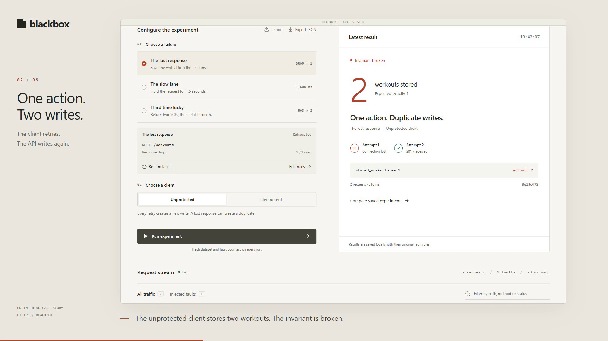

# Blackbox

**Test what your app does when an API request goes wrong.**

Blackbox runs between your app and its API. It can delay a request, return an error or drop a response. You can then see what happened and compare the results.

Built with **Go, React, TypeScript and SQLite**. Runs locally on your machine.

[](docs/images/blackbox-demo.mp4)

[Watch the 74-second demo](docs/images/blackbox-demo.mp4) - real requests, with captions.

## Why use it?

Imagine your app sends a request to save a workout. The server saves it, but the response never reaches your app. Your app tries again and accidentally saves the workout twice.

Blackbox lets you reproduce that problem on purpose. The included demo compares two approaches:

- **Unprotected:** retrying creates a second workout.
- **Idempotent:** retrying uses the same key, and the demo API recognises it. Only one workout is saved.

This protection must be implemented by the API. Blackbox helps you test it.

## What you can do

- Simulate lost responses, slow requests and HTTP errors.
- Inspect what the server returned and what the client received.
- Compare experiments and export their results and settings.
- Try the included demo or connect your own API.

## Run locally

You need **Git, Go 1.26+, Node.js 24 and npm** to build the project.

On Windows, open PowerShell:

```powershell
git clone https://github.com/nerifilipe/blackbox.git
cd blackbox
powershell -NoProfile -ExecutionPolicy Bypass -File scripts/build.ps1
.\dist\blackbox.exe serve
```

Already have the repository? Run the last two commands from its folder.

Open **[http://127.0.0.1:9090](http://127.0.0.1:9090)**. Stop the server with **Ctrl+C**.

On Linux/macOS, build and start from the repository folder with:

```sh
sh scripts/build.sh
./dist/blackbox serve
```

Once built, Blackbox runs as a single executable without Go or Node installed. The published v0.3.0 package has the older interface; build from source for the design shown here.

## Try your first experiment

1. Select **The lost response** and **Unprotected**, then click **Run experiment**.
2. You should see **2 workouts stored**. The duplicate is intentional: you have reproduced the bug.
3. Select **Idempotent** and run again. You should now see **1 workout stored**.
4. Open **Request stream** to inspect the lost response, or **Experiments** to compare both runs.

Each demo run starts with fresh test data. Results are saved locally.

## Use your own API

If your API runs on port 8000, start Blackbox with:

```powershell
.\dist\blackbox.exe serve -target http://127.0.0.1:8000
```

Send your app's requests to **`http://127.0.0.1:9091`** instead of directly to your API. In Blackbox, edit the rules to match the request method and path you want to test.

The built-in demo button is disabled for external APIs. Use your own app or HTTP client to send requests.

## Tests and documentation

The project has been checked with Go tests, **26 browser test cases** across desktop and mobile, and **62 checks against JSON Server**, an independent API project.

- [Test results and scope](docs/interface-redesign.md)
- [Run the JSON Server tests](integrations/json-server/README.md)
- [Fitness Tracker integration](docs/fitness-case-study.md)
- [How Blackbox works](docs/architecture.md)

Blackbox is a local development tool for HTTP requests and responses. It does not support WebSockets or streaming. It records request metadata, not headers or bodies.

## License

MIT.
