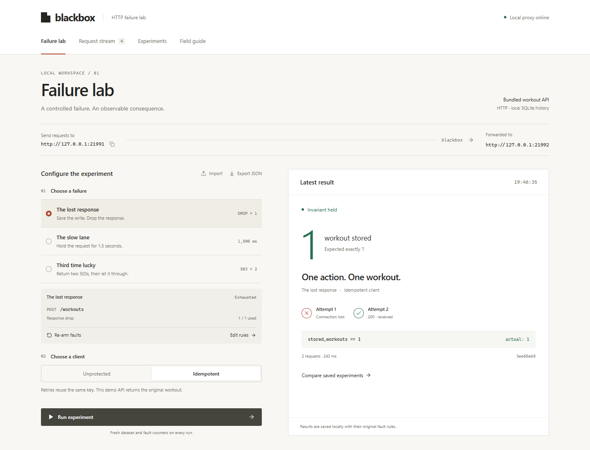
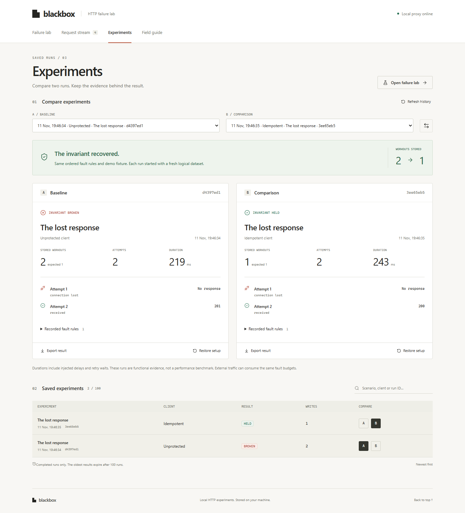

# Console redesign — 11 November 2026

The console now uses a light workspace with top navigation, a compact list of fault scenarios and a result panel centred on the number of persisted writes. The request inspector places the upstream response next to the client outcome. History and the field guide use the same visual system.

The work changes the React console, its CSS and browser tests. The Go proxy, API contracts and database schema are unchanged. No external fonts, illustrations or runtime services were added.

## Interaction changes

- Scenario buttons and traffic filters expose their selected state; navigation exposes the current page.
- Page changes return to the top, including opening comparisons and restoring saved setups on mobile.
- The editor opens with focus in the JSON field. Native dialogs return focus to the triggering button on Escape.
- Dialogs have accessible names, including a space between the HTTP method and path.
- A skip link reaches the main content. Focus outlines and reduced-motion preferences are supported.
- Disconnection disables mutations and visibly marks retained data as potentially stale. Reconnection preserves the chosen client.
- External targets hide the bundled client's mode selector and keep the demo action disabled.
- Request rows become compact two-line entries on mobile; long paths truncate in the stream and wrap in the inspector.

## Checks performed

Windows, Chrome, Node.js 24 and the workspace's Go 1.26 toolchain were used.

| Check | Result |
| --- | --- |
| TypeScript and Vite production build | Passed; frontend embedded in `dist/blackbox.exe` |
| `go test ./... -count=1 -cover` | Passed; `internal/lab` statement coverage 70.6%, CLI 19.3% |
| `go vet ./...` | Passed |
| Browser suite | All 26 distinct cases passed after corrections, across desktop and mobile |
| Unmodified JSON Server 0.17.4 | All 9 scenarios / 62 assertions passed against the redesigned build |
| External-target UI | Five checks per viewport passed, including the actual dropped-response inspector |
| Visual review | Desktop, 390 px mobile, history, guide, empty state, results and request inspector inspected |
| Video | MP4 fully decoded; Chrome loaded the 1920 × 1080 video and sought to seven positions without errors |

The last full browser run passed 24 cases and found an accessible-name issue in the two keyboard cases. After the correction, both affected cases passed in a targeted rerun. Both history cases were also rerun successfully after adding scroll restoration. The evidence records these separate executions rather than presenting them as a single clean run.

Earlier iterations also found that React's mount-time autofocus did not focus a textarea inside an initially closed dialog. Focus is now set when the dialog opens. Two old heading selectors were updated to use exact accessible names after the navigation copy changed.

Windows sandbox restrictions prevented one Playwright run from cleaning up its child server. That exact owned process tree was identified and terminated; subsequent browser test runs had permission to clean up their own processes.

## Evidence

- [Browser results and iteration metadata](evidence/interface-redesign/browser-tests.json)
- [Independent API report](evidence/interface-redesign/json-server-report.json)
- [Readable API report](evidence/interface-redesign/json-server-report.md)
- [Actual experiments recorded for the video](evidence/interface-redesign/recorded-experiments.json)
- [Media verification and hashes](evidence/interface-redesign/media-check.json)
- [Video production and reproduction](portfolio-video.md)

## Publication state and scope

These are local results. No commit, push, new GitHub Actions run or release was made as part of the redesign. The public v0.3.0 ZIP retains its previous interface. The local executable contains the redesign.

The API integration was run before the final editor-focus and accessible-name refinements; those refinements do not change proxy behaviour. The console was rebuilt after the final changes; focused keyboard and history-navigation checks cover the corrections. Screenshots show the same visual design. The video shows the same design and real behaviour, recorded before the final accessible-name whitespace correction favicon addition and page-scroll restoration.

This work does not establish human usability feedback, a complete accessibility audit, security certification or throughput performance. The earlier Fitness Tracker evidence remains a separately dated integration record; that backend was not changed or rerun for this console-only work.
