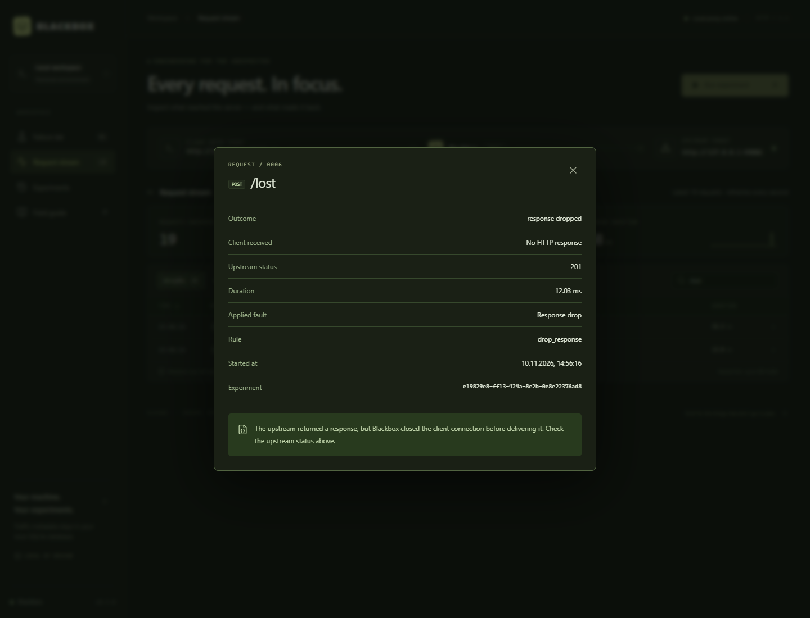

# Independent project validation — 2026-11-10

**Result: the published Blackbox v0.3.0 passed the tested compatibility scenarios against typicode/JSON Server.**

The target was the original [JSON Server 0.17.4](https://github.com/typicode/json-server/tree/v0.17.4) npm package, with locked dependencies and no source modifications. It is an independent open-source API prototyping tool, not a Fitness Tracker fixture or production service. Tests used Node.js 24.14.0, Python 3.14.3 and Windows, with Chrome for UI inspection.

## Published-package check

The ZIP and checksum were downloaded from the public [v0.3.0 release](https://github.com/nerifilipe/blackbox/releases/tag/v0.3.0). The archive matched both the uploaded checksum and GitHub's asset digest:

```text
57d9f2e83fa8a1d1f1cf21da36801c3828f69d6f62ea2e34fdc30e2aeebfb582
```

The archive extracted successfully into a fresh directory containing spaces. Its `Start-Blackbox.cmd` launched with a PATH containing Windows system tools but no Go or Node installation. The console and embedded assets loaded. CLI fragile/resilient cases returned the expected exit codes and stored-workout counts, and scenario export worked. Owned processes were stopped and the console port closed.

**15 package/launcher checks passed.** [Evidence](evidence/json-server/release-smoke.json).

## External API results

**Nine scenarios and 62 assertions passed.** Every case used the executable from the downloaded archive, not a newly modified build.

| Scenario | Observed result |
| --- | --- |
| CRUD and request forwarding | UTF-8 JSON, filtering, PATCH and DELETE worked; query/header/body markers were omitted from recorded metadata |
| Lost POST response | Upstream 201; no downstream response; retry returned 201 and created a second record |
| Lost PUT response | Retry returned 200; one resource and identical final state remained |
| Two injected 503s | No writes during failures; third attempt created one record |
| Exact matching | Other methods and paths passed; a query string did not bypass the matching path |
| 700 ms latency | Delay was visible at client and proxy; the one-use budget was respected |
| Cancellation during latency | Client timed out; proxy recorded cancellation; no upstream request or later write occurred |
| Control validation | Invalid rules returned 400 without replacing the valid scenario; bundled demo invocation returned 409 for the external target |
| Proxy restart | Events and scenario survived; counters reset |

The same run also passed **five UI checks per viewport**, on desktop and a 390 × 844 mobile viewport: the custom-target explanation appears, the bundled demo is disabled, the lost-response event can be inspected, the page does not overflow horizontally, and no JavaScript error occurs.

[Full JSON evidence](evidence/json-server/report.json) · [Generated summary](evidence/json-server/report.md).



## Main finding

**The same Idempotency-Key header did not prevent duplicate POST records.** One logical action produced two IDs after the first response was dropped. The Blackbox test passes because it exposes the failure; the application's one-record invariant is explicitly recorded as false. JSON Server does not implement the needed deduplication behavior for this endpoint, and Blackbox does not supply it on the application's behalf.

Repeating a PUT of the same representation to an existing resource preserved the final state in the second experiment. This demonstrates a specific state property, not exactly-once execution of arbitrary effects.

## Test adjustments and limitations

Initial harness runs read JSON Server's file too early: its CLI uses asynchronous writes and Windows briefly locked the replaced file. The harness was corrected to perform a bounded persistence wait before assertions and retries. A browser locator was also corrected to match the actual request-detail dialog. These were test-harness issues; the published Blackbox executable was unchanged.

The Windows sandbox blocked process-tree cleanup for the batch launcher. That smoke check was repeated with permission to stop its owned process tree and completed successfully. Ordinary external-target test processes stopped automatically.

No Blackbox defect was found in this scope. This is not human usability feedback, a security review, a throughput benchmark, or a claim about every API. JSON Server is a prototyping API; authentication-heavy applications and streaming protocols require separate assessments.

The checks and lockfile are available in [integrations/json-server](../integrations/json-server/README.md). They can be rerun against future binaries. New CI steps are prepared locally; they have not yet run remotely.
